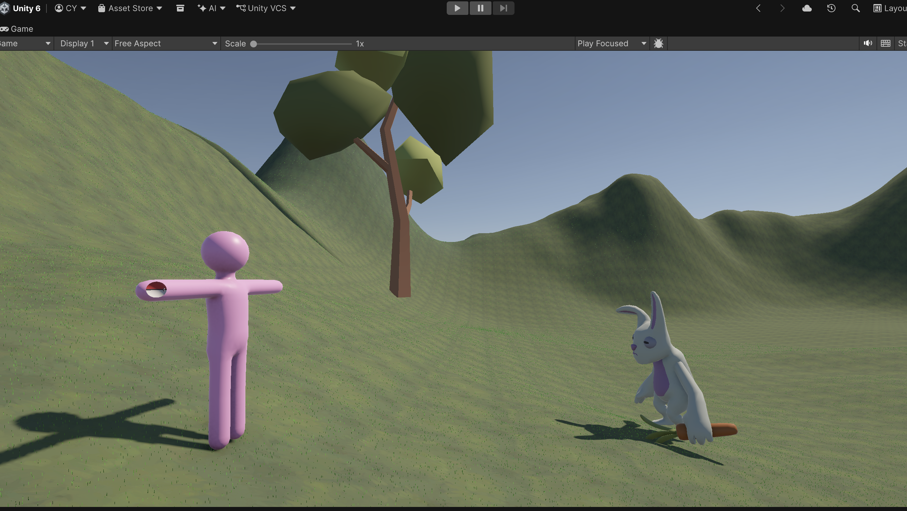

作業五：寶可夢風格場景建立

1.專案截圖

2.GitHub 連結
https://github.com/YICHING13/1151VR-HW5-414262363-wyc

3.YouTube 影片連結
https://youtu.be/uZEqyH_1KEY?si=Ra1PkNKikSau317G

4.製作流程
   
    1.使用 Unity 6 建立 3D 專案，設定場景及基本環境。

    2.使用 Terrain 工具建立地形，透過 Raise/Lower Terrain 和 Smooth Height 製作起伏山丘，並加入草地材質、樹木及草叢素材。

    3.匯入 Stick Man、Bunny 及 Pokeball 3D 模型，調整角色大小、位置與方向，安排訓練家和怪獸分別位於場景左右兩側。

    4.調整 Main Camera 的位置與角度，以側面視角呈現角色、精靈球投擲路線及背景山丘。

    5.使用 Animator 設定 Stick Man 的 Idle 動畫，並將精靈球綁定至人物的 RightHand 骨架，使精靈球能跟隨手部移動。

    6.使用 C# 撰寫 PokeballCapture.cs，透過手臂骨架旋轉製作向後蓄力及向前揮手的投擲動作。

    7.按下 Space 後，精靈球脫離右手，利用 Coroutine 與 Vector3.Lerp 控制精靈球沿拋物線由左向右飛向 Bunny。

    8.精靈球抵達目標後，透過縮放動畫使 Bunny 逐漸縮小並消失，同時使用 Particle System 產生金黃色粒子特效，模擬收服成功。

    9.執行專案並測試人物動畫、精靈球飛行路徑及收服特效，確認功能正常運作後進行螢幕錄影。

相關操作
Play：執行 Unity 場景，開始遊戲。
Space：觸發 Stick Man 的投擲動作，使精靈球從右手飛出並沿拋物線飛向 Bunny。
收服效果：精靈球抵達 Bunny 後，Bunny 逐漸縮小消失，同時產生金黃色粒子特效。
重新執行：停止 Play 後再次執行，即可重新觀看完整的投擲與收服動畫。

